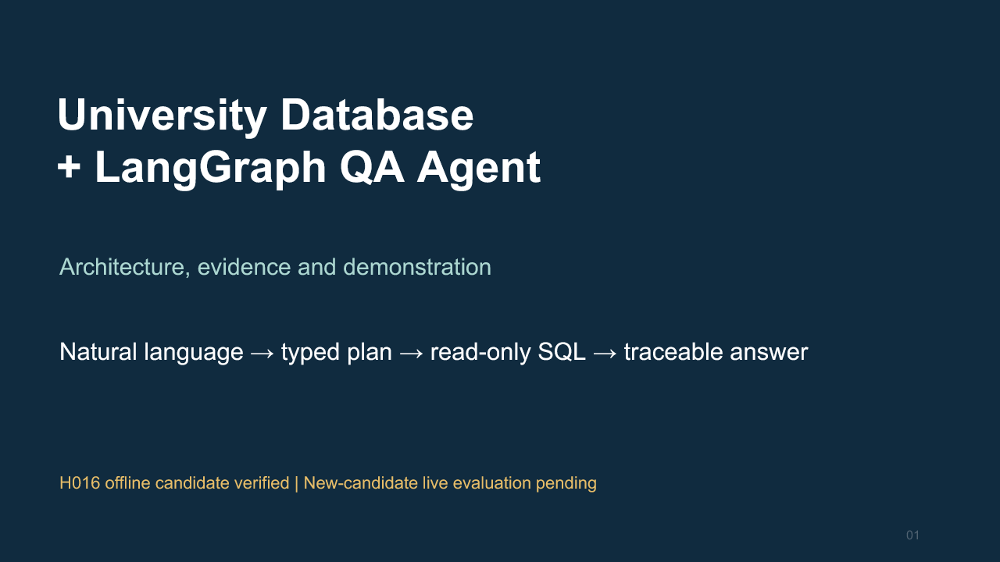

# UniversityDB defense presentation

[Download the editable PowerPoint](UniversityDB-defense.pptx) · [Speaker guide](speaker-notes.md)

24 English slides with editable diagrams, 16 native tables and speaker notes on
every slide. Slides 1–22 form the main talk (approximately 18–22 minutes); slides
23–24 support the code walkthrough and questions. Follow with the exact isolated
offline sequence in [the E2E guide](../manual-e2e.md) and [README](../../README.md).

The deck covers assignment goals, development stages, owner/chat/OMX/review roles,
schema and grade semantics, LangGraph state and control flow, typed contracts,
dependencies, clarification, the configured model and bounds, SQL safety, tracing,
tests, the historical live failure, the shared resolver repair, Library portability,
trade-offs, production gaps and demonstration steps.

Evidence cutoff: published documentation/source checkpoint `f43c2b1`; tested H016
executable `58f2fe9`. Later presentation packaging does not change product code or
claim another full test. The old candidate's corrected live result remains 10/48.
The repaired candidate has offline evidence, not a new real-model score. The demo
uses injected proposals with real LangGraph/SQLite/UI execution; say so explicitly.

Source links are in each slide's notes and the companion guide. No private raw
assignment PDF, credentials, runtime state or full private chat transcripts are
included. Presentation preparation is not a completed owner rehearsal.

All slides were rendered and visually reviewed. Package integrity, geometry,
heading/list layout, fonts, native tables and first-party import passed. Native
PowerPoint execution was not tested. The first-party live authoring environment
failed before writing slides, so the deliverable is the validated local PPTX.
